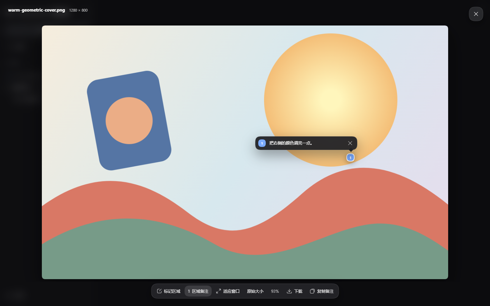

> 未发布候选 `dsh-image-viewer@1.0.0-alpha.1` 改用 DSH 0.2.2-rc.1 的公开图片菜单；RC1 Windows 隔离 UI 验收已通过，旧六版证据不适用于本次修改。详见[候选范围](docs/unreleased.md)。下方稳定版安装说明保持独立。

<div align="center">

# DSH Image Viewer · 图片查看器

放大、浏览、下载并标注 DSH 已显示图片的轻量查看器。

[](https://github.com/WSL043/dsh-image-viewer/actions/workflows/ci.yml)
[](https://www.npmjs.com/package/dsh-image-viewer)
[](https://www.npmjs.com/package/dsh-image-viewer)
[](#安装)
[](LICENSE)
[](https://github.com/WSL043/dsh-image-viewer/stargazers)

[English](README.en.md) · [安装](#安装) · [隐私](#隐私)

</div>

<p align="center">
  
</p>

## 候选范围

普通图片点击、预览、原文件拖放和常规操作保留官方 DSH 实现。右键会话中的图片选择“标注图片”才打开插件，只处理明确选择的图片；不再截获文档点击或解析官方 DOM 拼接图库。标注工具保留必要的缩放、拖动与导出。RC1 的草稿缩略图尚未提供公开图片菜单，插件不为它补 DOM 钩子，仍用官方预览。

## 功能

- 以鼠标位置为中心缩放、拖动、双指缩放和双击查看原始大小；支持适应窗口、键盘切换与多图浏览。
- 显示图片名称、尺寸和缩放比例；大图可查看 100%，调整窗口后图片仍可见。
- 原图下载显示可用进度，可取消或重试；切图或关闭查看器会取消下载。
- 提供清晰的加载和错误状态，失败可重试；切图会重置拖动状态并隔离各图标注。
- 点击标记区域并在编号旁编辑备注；Enter 保存，Shift+Enter 换行。
- 关闭原生 DSH 图片时，可将编号图片和备注加入当前会话草稿，保留已有文字但不自动发送；避免重复添加，失败可重试。
- 适配 DSH 亮/暗色主题、响应式布局、焦点约束和减少动态效果设置。

## 安装

[DSH-Portable](https://github.com/WSL043/DSH-Portable) 0.9.9 起的新包将不再预装社区插件，本插件可按需安装；历史包中已安装的插件保留。1.x 官方桌面便携线也不预装社区插件。

### 插件页面（推荐）

1. 先核对目标 DSH、profile、`latest` 解析出的实际插件版本及其 peer 要求，再打开 **插件 → 添加插件**。
2. 在“包名或地址”中粘贴下面这一行并点击安装：

```text
dsh-image-viewer@latest
```

3. 查看安装结果；仅在页面要求时刷新或重启。

<!-- dsh-compatibility -->
稳定版支持窗口见 [stable 维护分支](https://github.com/WSL043/dsh-image-viewer/blob/stable/README.md#安装)，安装保护见 [stable AGENTS.md](https://github.com/WSL043/dsh-image-viewer/blob/stable/AGENTS.md)；不以本分支候选的 peer 范围代替。
<!-- /dsh-compatibility -->

稳定维护每小时检测上游；兼容补丁通过验收后自动发布到 npm 和 GitHub Releases，失败则停发并报告错误。此流程不发布或扩大本分支候选的支持范围。

### 终端安装（可选）

官方 DSH Desktop 请先通过应用的 **Manage dsh Command…** 安装自带命令；完成一次初始化后，完全退出应用再运行 `--profile desktop`。DSH-Portable 0.x 和网页版使用 `--profile web`。

```sh
dsh plugin --profile desktop add dsh-image-viewer@latest
dsh plugin --profile web add dsh-image-viewer@latest
```

终端操作后按宿主提示重新启动对应 profile。

## 更新与卸载

在 **插件** 页面更新或卸载；没有更新操作时，在“添加插件”中输入目标 `包名@版本`。终端卸载可用 `dsh plugin --profile web remove dsh-image-viewer`；官方 Desktop 按上方说明退出应用并将 profile 换为 `desktop`。

卸载仅移除标注入口和工具，官方查看器始终保留；不会删除会话或图片。

## 隐私

插件只读取 DSH 已渲染的图片 URL，不调用模型或读取供应商凭据。标注通过 DSH 附件和草稿接口交由用户决定是否发送；页内重开时仍可看到备注，不代表已发送或永久保存。

## 反馈

请使用[问题反馈表单](https://github.com/WSL043/dsh-image-viewer/issues/new?template=bug-report.yml)并提供插件/DSH 版本、系统、图片位置和失败操作。不要提交私人图片、凭据或完整会话日志；安全问题请通过 [GitHub Security Advisories](https://github.com/WSL043/dsh-image-viewer/security/advisories/new) 私下报告。

## 许可证与质量

[MIT](LICENSE)。候选验收和剩余限制见[未发布记录](docs/unreleased.md)。

## 开发者

调用 `nativeImageViewer.open()` 时，`download.onInvoke` 会收到 `{ item, src, signal, onProgress }`。将 `signal` 传给下载请求，并用 `onProgress({ loaded, total })` 上报字节数；文件大小未知时省略 `total`。自定义传输需响应 `signal` 以支持取消；下载权限与原图校验仍由图片提供方负责。

[English](README.en.md) · [Awesome DSH 收录](https://github.com/awesome-dsh-plugin/awesome-dsh-plugin/blob/main/data/plugins/WSL043__dsh-image-viewer.yml) · [会话管理插件](https://github.com/WSL043/dsh-chat-manager)
